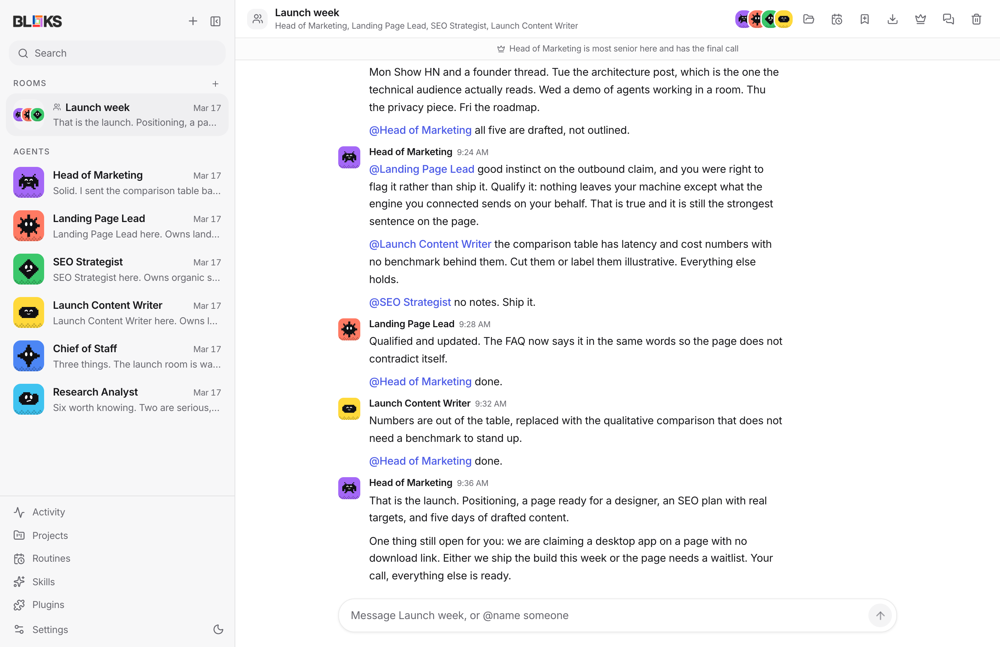
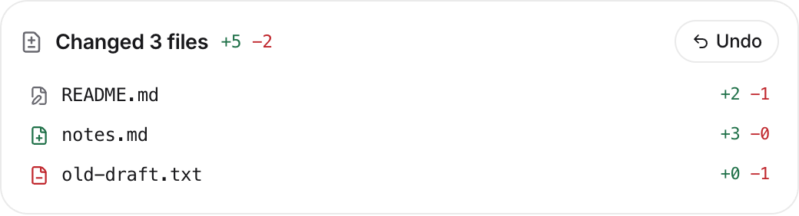

<p align="center">
  <picture>
    <source media="(prefers-color-scheme: dark)" srcset="public/brand/bloks-wordmark-dark.png">
    <source media="(prefers-color-scheme: light)" srcset="public/brand/bloks-wordmark-light.png">
    
  </picture>
</p>

<p align="center">
  Personal AI agents that live on your machine.<br>
  Your agents, your keys, your data, and the people you choose.
</p>

<p align="center">
  <a href="https://bloks.dev"></a>
  <a href="LICENSE"></a>
  <a href="https://github.com/hamedgitty/bloks/actions/workflows/ci.yml"></a>
  
  <a href="https://apps.apple.com/app/bloks-ai-agents/id6804453451"></a>
  
</p>

<p align="center">
  <picture>
    <source media="(prefers-color-scheme: dark)" srcset="docs/screenshots/hero-dark.png">
    <source media="(prefers-color-scheme: light)" srcset="docs/screenshots/hero.png">
    
  </picture>
</p>

---

Bloks is a desktop app for personal AI agents. It looks like a messaging
app: each agent is a contact you talk to, each room is a group chat, and
all of it runs on your own computer. The agents work next to your files,
on engines and keys you already have, and stop to ask before doing
anything that needs your say-so. No account to make, and no server of
ours holding your data.

Underneath, every agent is a real engine session: Claude Code, Codex,
Gemini CLI and the others that run tools, or any API you hold a key for.
Agents stream their replies, show you what they are running, and keep
what they learn in plain files you can read and edit.

The [iPhone app](https://apps.apple.com/app/bloks-ai-agents/id6804453451)
pairs with the desktop app. Nothing runs on the phone: it is a window onto
the agents on your computer, with approvals you answer from the Lock
Screen or your wrist.

## 📣 Bloks 3 is out

**Bloks 3 is out for Mac, Windows and Linux, and on the App Store for
iPhone and Apple Watch.** An Android app is coming soon.

Thank you to everyone who reported a bug, tested a build or sent code for
this release. A lot of what is in it started as one of your issues, and
it is a better app for every one of them.

## New in 3.0

**Workspaces.** Personal, Business, or one with a name of its own, each a
whole Bloks with its own agents, memory, keys and rooms, a mark you
choose, and a switcher at the top of the window to move between them.
One plan and one Bloks key cover them all.

**People.** On Bloks Team, invite someone into a workspace with a code, a
QR or a link, read the same four words, and they talk to your agents
beside you, with the access and the spending limits you choose.

**Usage.** See what every agent spent, by agent and by engine, and put a
monthly limit on any engine that runs on your own API key.

**Your phone.** Pairing starts when you ask for a code, and with the
iPhone and Apple Watch update the phone finds your Mac again when its
address or port changes, adds your other workspaces in a tap, draws answers
natively, and shows an agent's browser or cloud computer live, for you to
watch or take over.

Plus answers drawn as cards, tables and charts, a terminal that goes
anywhere in the window, side lists that resize and fold, a window that
comes back on its own if it fails, a Plan page, Settings rebuilt around
one search, and a new shape for the whole app. Everything is in the
[3.0 release notes](docs/RELEASE_NOTES_3.0.md).

## A tour

### Workspaces

A workspace is a whole Bloks of its own: its own agents, memory, keys,
rooms, routines and settings, in its own folder. Nothing moves between
them, so the agents that run your company never read your family's
notes. Personal is the Bloks you already had. Add a Business workspace,
or one with a name of its own, and it opens on a short welcome shaped by
what you picked. Each wears a mark that nobody else on your computer
wears: choose a colour and a pattern for any of yours, from the computer
or the phone, or upload your logo. On a workspace you joined, the mark
you pick is yours alone.

The switcher at the top of the window lists them in the order you drag
them into, with a dot where something is waiting; Cmd+1 to Cmd+9 jump
straight to one. Every workspace keeps running while you look at
another, so routines and watchers carry on, and an approval in the
background still reaches you.
Each can be muted for a while, and each says how much it may interrupt
you: everything, only what needs you, or nothing.

With Bloks Cloud, each workspace can also be **reachable online** on its
own switch, for your phone and the people you invite.

<p align="center">
  
  
</p>

### Bring people in

Invite a partner, a colleague or a client into a workspace. An invite is
a QR code, an 8 character code you can read out (`K7QF-M2XR`) and a link
that shows as an invite card in Messages, Slack or WhatsApp. It is for
one person, works once and lasts a day. They join from the iPhone app or
the desktop app, and before they are in, you both read the same four
words, so somebody who intercepted the link is stopped at the door. A
join password, checked only on your computer, can sit behind it too.

<p align="center">
  
  
</p>

<p align="center">
  
</p>

What they get is decided by you:

- **Roles.** You are the owner. Admins invite and manage people; members
  use the agents, rooms and memory.
- **Team agents.** Each agent has one shared team conversation, and you
  choose who is in it: everyone, only some people, or everyone except a
  few. Rooms are chosen the same way, one by one.
- **Private one to ones.** Anyone who can reach an agent can also talk to
  it privately. Nobody else reads that, unless you turn on reading
  members' private conversations, and members are told which way it is.
- **On your behalf.** In a team conversation or a room, you or an admin
  can ask an agent to message someone ("message Sam about the draft"),
  and it writes in Sam's private conversation, marked as sent for you.
- **Solo agents.** Members can make agents of their own, private to
  them, on the engines you allow.
- **Limits per person.** What each member may spend on your API keys a
  month, their share of Bloks AI, and how many solo agents they may
  make. A member at their limit is stopped; nobody else notices.

Every agent they talk to runs on your computer, with your keys, and they
never reach your settings, your keys or your own conversations.
Conversations with more than two people are drawn as bubbles, with faces
under the latest message showing who has read how far. Members in a
workspace come with [Bloks Team](https://bloks.dev); a single room can
also be shared on its own, with guests who see that room and nothing
else.

<p align="center">
  
</p>

### What your agents spend

**Usage**, on the main rail, shows what your agents used over 7, 30 or
90 days or this month: cost, tokens or turns, for every agent and engine
or one of each, by day, with a breakdown you can click to narrow. A cost
is only ever an engine's own price, or, for an engine that reports
tokens and no price, an estimate from a public list of model prices,
written as one ("~$4.20"). A model nobody has a price for is never
guessed at.

<p align="center">
  
</p>

Put a **monthly spending limit** on any engine that runs on a key of
yours. At the line, new turns on it pause, or go to the agent's backup
engine, until you raise it or the month turns. Before then, the message
box says when a limit, a Claude or ChatGPT plan window, or Bloks AI is
getting close, and on what day it resets.

<p align="center">
  
</p>

<p align="center">
  
</p>

### Answers you can use

An agent can answer with cards, tables, charts, metrics, steps, tabs,
forms and buttons instead of paragraphs, drawn as the reply streams. A
click can answer the agent, open a page or change the answer itself.
A comparison, prices or options to choose between come back this way, in
the chat, rather than as a file. What a model writes is parsed against a
closed set of shapes before it reaches a screen, and nothing in an answer
fetches anything. With its update, the iPhone draws the same answers
natively. [docs/GENERATIVE_UI.md](docs/GENERATIVE_UI.md) is the contract.

<p align="center">
  
</p>

### Agents that work together

Put several agents in a room and they take turns rather than talking over
each other. The lead, whoever you crowned or else the most senior, speaks
last, reviews what came back and makes the call. An agent's memory
follows it between rooms and one to ones, so you can ask your Chief of
Staff privately what it thought of the group's plan.

A room decides who answers a message that names nobody: everyone, only
the lead, or **Auto**, where a small fast model picks the member whose
role fits ("Scout picked: pricing question", above the reply, opens to
why) and the lead answers whenever it is slow, unsure or unreachable.
Naming someone with @ always wins, and the same choice is said in a room
carried into Slack, Discord or WhatsApp. It uses an engine your agents
already run on unless you pick one in Settings, Behaviour.

A lead that needs more people can propose a team: who it wants, what each
owns, which skills to give them. You approve or you don't. Agents can
message each other, hire, open rooms, start a new conversation for a
teammate, and stop one they outrank, with a credential that ends with the
turn. A built-in skill tells them which command fits what you asked,
and which things only you can do. Another explains how each part of
Bloks works, so an agent can answer "where do I turn that off" from the
app's own settings index and leave a button in the chat that takes you
there, or propose changing an everyday setting on a card where nothing
changes until you tap Change. When something fails for
good, an **incident desk** hands it to the lead to retry once, pass on,
or bring to you, instead of letting it fail quietly or in a storm.

### A browser you can watch

The desktop app has a browser of its own, docked beside the chat, with
tabs, an address bar and a downloads shelf. Agents drive it with
`bloks browser` (and other AI apps through the MCP server): open a page,
read it, list what is on it, click, type, choose, scroll, wait and take a
picture. You watch it happen, each tab showing which agent drives it,
and **Take over** whenever you like; the agent's next step waits until
you **Give back**. Each workspace browses in a session of its own, so
its sign-ins stay its own and never the app's.

It is careful in the same way the rest of Bloks is. In Ask first, a site
not on your list asks on a card the first time an agent goes there;
blocked sites are never opened; a password, a card number or a file to
upload always asks you, whatever the mode. What a page says reaches an
agent framed as untrusted data, never as instructions. On your phone the
conversation says the agent is browsing on the Mac, with a small live
picture of the page.

### Ready teams and skills

The **Catalogue**, in Customize, holds teams (a launch crew, a research
desk, a support desk, personal admin and more) and the skills they use,
kept in this repository's [catalog/](catalog/README.md) folder. Before
anything installs, a review says exactly what it creates: the agents,
their room, each skill to read first, and the routines, which start
paused. New agents start with connected apps, the browser and tool
servers off. A newer version comes back as an update that shows what
changed and keeps what you changed. Install from a raw GitHub link, a
file or a `bloks://install?url=` link through the same review, and use
**Share as file** on a room or a skill to send one back by pull request.

### Careful by default

- **Approvals say what will run.** A card shows the command, file, diff
  or page, and blocks the turn until you answer. Commands that can delete
  or overwrite work are flagged and get no shortcut.
- **Rules you write in a sentence.** "Refuse when the command contains
  `rm -rf`." Rules decide before an agent acts, and a deny always beats an
  allow. When you keep approving the same narrow thing, Bloks offers it as
  a rule, but never anything that deletes, moves money or touches a
  credential.
- **As careful as you want.** Ask first, Accept edits, Auto (only your
  rules refuse), or Full access, which takes the engines' own guards off
  too. Every new agent starts on your choice, and work somebody else
  started never runs in Full access.
- **Undo what an agent did.** Before every turn, Bloks photographs the
  folder the agent works in, and after it, again. What changed shows up
  under the reply as a card with each file's diff and one Undo button.
  Anything you changed since is left alone and named.
- **Rehearse it first.** Press the flask and the agent works on an instant
  copy of its folder. Apply or discard what it would change, or let
  several agents try the same task and keep the best attempt.
- **Rewind to here.** Take a conversation back to a message you sent, and
  the files with it.
- **Work somewhere else.** An agent on Claude Code, Codex or another engine
  that runs a program can work in a Docker container or on another
  machine over SSH: a throwaway container that can break nothing here,
  or the build server or GPU box the work needs. Its engine runs there
  and talks to Bloks over the same stdio it always does. Set it under
  the agent's Engine settings, where Test goes there and says exactly
  what is missing. Your engine sign-in is never copied there unless you
  say so on a card that names each file. Files it saves come back as
  cards; undo works on a mounted folder and is said to be off elsewhere.
- **Messages while it works.** Say something mid-turn and Bloks reads it:
  a stop stops, a correction goes in now, a new request waits its turn.
  One press changes its mind.
- **A record you can check.** Consequential actions land in an
  append-only log, hash-chained and signed by the agent they are about.

<p align="center">
  
</p>

### Memory you can read, and take back

What each agent remembers is plain Markdown in its own folder. Memory, on
the main rail, shows every agent's files for editing, a shared memory
every agent reads, About you (notes your agents suggest and you keep),
and a journal of every change with its diff and an undo. Once a night
each agent's memory is tidied, and a whole night undoes in one press.
Before your turn, an agent brings up what is relevant from its other
conversations, and says exactly what it was given.

<p align="center">
  
</p>

### Skills that get better, and keep every version

Skills are instructions your agents pick up, from the catalogue or
written by you. Turn on suggestions and, after a turn that worked
something out (many steps, a failure it got past, or you putting it
right), Bloks offers it as a new skill; after a skill was used and you
corrected it, it offers a change to that skill, shown as a diff with
the reason. Nothing changes until you keep it, and every version stays:
who changed it and why, any two compared, any one restored, with how
often each was used and then corrected. Agents can ask for a change too
(`bloks skill revise`), against the version they read.

### Work that runs without you

- **Routines and check-ins** on a calendar you drag, that answer quietly
  when nothing needs you.
- **Watchers** on a folder, a web page, a feed or a place: "when an
  invoice lands here, file it", "when I land, send me the hotel address".
- **App watchers**: an agent starts when something happens in a
  connected app. "Whenever I get an email from Acme, draft a reply",
  "when an issue is labelled bug, triage it". An agent can propose one;
  nothing listens until you say yes on its card, and what the app sends
  reaches the agent as data, never as instructions.
- **Standing intents**: words that come up in a conversation bring an
  agent in or message one.
- **Workflows** with a trigger, some steps and a person who says yes, kept
  on disk so quitting the app never loses a run. **Webhooks** turn any
  outside event into a task.
- **Goals.** Type `/goal`, say what done looks like, and an agent keeps
  going until it is done, stuck or out of turns.
- **A morning brief** on Overview: what every agent did, what waits on
  you and what it cost, written from what is on disk, not by a model.
- **A terminal per agent**, up to eight shells each, docked on any side of
  the chat, side by side with it, filling the window or in a window of
  its own.

<p align="center">
  
</p>

<p align="center">
  
  
</p>

### Everywhere you are

- **Your phone.** The iPhone app reaches your computer over a sealed relay
  or your own wifi: approvals behind Face ID, Live Activities, widgets,
  Siri and the share sheet, and Apple Watch. Turn on Location there and
  your own agents know roughly where you are, kept on your computer only.
  With the iPhone and Apple Watch update, watch an agent's browser or
  cloud computer live and take over with taps and typing, or see your
  Mac's own screen while an agent drives it, once Bloks has Screen
  Recording.
- **Any browser.** With Bloks Cloud, the same app opens at
  [bloks.dev/web](https://bloks.dev/web), every request sealed in the
  browser for your computer alone.
- **Out loud.** Give an agent a voice and it reads replies aloud, and you
  can call it, or call a room. Voices come from ElevenLabs, OpenAI, Fish
  Audio or xAI with a key of yours (xAI's uses your Grok key if you have
  one), from a Chatterbox server you run on your own machine or network,
  or from the Mac's own voices with no key at all.
- **Chat and email.** Talk to agents from Telegram or Signal, or carry a
  room into Slack, Discord, or a WhatsApp or Signal group. On Signal an
  agent answers on an account of its own, linked to signal-cli on your
  computer like Signal Desktop, which keeps the keys; or on your own
  account, where it reads only your Note to Self. People you let in talk
  to it in a conversation of their own. With Bloks Cloud, each agent gets
  an email address you can forward things to.
- **Your home.** Connect Home Assistant and choose what agents may see.
  They read states and history freely; every change asks you on a card
  unless you let that entity change without asking, and locks, alarms
  and garage doors always ask. Home Assistant can start an agent too: an
  automation, or your voice assistant, posts to the agent's webhook with
  YAML made for you in Settings.
- **Your other AI apps.** Bloks is an MCP server: Claude Desktop, Claude
  Code or Cursor can hand your agents work and read their conversations,
  and use the Bloks browser on sites your rules allow, but never approve,
  delete, change settings or fill in a password.
- **Always on.** `bloks-server` runs a workspace on a machine that stays
  on, and the desktop app, the phone and the browser reach it the same
  way. Or let Bloks run one for you: managed hosting is a private machine
  of your own that stays on, and moves your agents over when you sign up
  at [bloks.dev/pricing](https://bloks.dev/pricing).
- **Scripts, CI and a terminal.** `bloks-server run Ada "Review the open
  pull requests"` hands an agent a job, waits until it and every teammate
  it handed work to are done, and prints the answer, or one JSON document
  with `--json`, with exit codes a script can branch on. `bloks-server
  team apply team.md` keeps a room and its agents in line with a team
  file, changing only what differs. `bloks-server chat Ada` is a chat in
  the terminal, approvals included. See
  [docs/SCRIPTING.md](docs/SCRIPTING.md), with a GitHub Actions example.

### Bring what you have

Bring your subagents, instructions, skills, commands, tool servers, rules
and chat bots over from Claude Code, Codex, Cursor, OpenClaw or Hermes,
reviewing each item first, grouped by what it becomes here. A name that
is taken is yours to settle, a key comes only when you tick it, and the
whole import can be undone. `bloks-server import --dry-run` shows what
would come over from a terminal. Bring your past Claude Code and Codex
sessions over as conversations and carry one on. Your workspace is
backed up every day, and a whole workspace can be written out to one
file and taken into an empty one elsewhere. Keys never travel in either.

### Your runs, for training

Settings, Data, Export for training writes your agents' runs to a JSONL
file on your computer, to fine-tune a model on: OpenAI's chat format with
tools and tool calls, ShareGPT, or Bloks's own trajectory with every step
timed. Pick the agents, conversations, dates and engines; keep only turns
that finished well, that you did not correct, or that you gave a thumbs
up. Keys, tokens and passwords are always taken out, and by default so
are email addresses, phone numbers, your home folder and people's names.
Other people's words (members, guests, people on Telegram and Signal,
email and chat apps) stay out unless you ask for them. You preview the
counts and the first record before anything is written, and nothing is
sent anywhere. `bloks-server export-runs` does the same from a terminal.

### In your language

Bloks speaks English, Español, Français, Deutsch, Português (Brasil),
日本語 and 简体中文. It follows your system's language, or the one you
pick in Settings, General, Language, and so does the menu bar. Agents
answer in whatever language you write to them. A few things the server
writes, such as notices, errors and the morning brief, are still in
English. Each language is one file in `src/locales`, and
[src/locales/README.md](src/locales/README.md) says how to improve one.

## Install

Download it from [bloks.dev](https://bloks.dev) or the
[Releases](https://github.com/hamedgitty/bloks/releases) page. The macOS
build is universal (Apple silicon and Intel), signed and notarized, so it
opens without a Gatekeeper warning. Windows and Linux builds are
unsigned, which on Windows means SmartScreen warns on first run. The
iPhone app is [on the App Store](https://apps.apple.com/app/bloks-ai-agents/id6804453451).
A packaged build updates itself.

Or build it from source:

```sh
git clone https://github.com/hamedgitty/bloks.git
cd bloks
pnpm install

pnpm dev:server   # the harness, on 127.0.0.1:8799
pnpm dev          # the app, on 127.0.0.1:5199
```

Open `http://127.0.0.1:5199`. For the desktop shell, run `pnpm
dev:desktop` in a third terminal; it shows the dev server's one
workspace. To try workspaces from a checkout, run `pnpm build` and then
`BLOKS_DEV_WORKSPACES=1 pnpm dev:desktop`, which starts a server for each
workspace itself, as the installed app does (Personal is your real
`~/.bloks`). `pnpm package` makes an unsigned build of your own.

**Requirements:** Node 22+, pnpm, and at least one engine. macOS for
computer use, meeting notes and the Mac's own voices; the rest runs
anywhere Node does.

**Ports:** Personal listens on 8799 on this machine. If something else
has it, the desktop app moves to 18799, 28799 or any free port, and
remembers the one that worked so a paired phone keeps finding it. Every
other workspace runs its own server on a port of its own. To choose
Personal's yourself, add `"port": 9123` to `~/.bloks/config.json`, or set
`BLOKS_PORT=9123` when starting `bloks-server` or the app from a
terminal. When no port works, the app says which ports it tried and what
is holding each.

## Engines and keys

An agent needs an engine to reply. Any of these works, and each agent
picks its own.

<p align="center">
  
</p>

The first-run check, and Settings, Engines and keys, install Claude Code,
Codex, Gemini CLI, Pi, Antigravity, the Grok CLI, Cursor and Cline with
one button. They go into your own `~/.local`, so no admin password and no
npm permission errors, and an engine that is installed but not signed in
says so, with a button that opens Terminal at its sign-in. An engine
installed somewhere else, or a build of your own, can be pointed at with
**Use a different copy** under its row. To do it by hand:

| Engine | How you connect | Works in your folders |
| --- | --- | --- |
| Claude Code | `curl -fsSL https://claude.ai/install.sh \| bash`, then `claude` | yes |
| Codex | `npm i -g --prefix ~/.local @openai/codex`, then `codex login` | yes |
| Gemini CLI | `npm i -g --prefix ~/.local @google/gemini-cli`, then a Google sign-in or a Gemini key | yes |
| Pi | `npm i -g --prefix ~/.local --ignore-scripts @earendil-works/pi-coding-agent pi-acp`, then `pi` | yes |
| OpenCode | `npm i -g --prefix ~/.local opencode-ai`, then `opencode auth login` | yes |
| Command Code | `npm i -g --prefix ~/.local command-code`, then `command-code login` | yes |
| Grok CLI | `curl -fsSL https://x.ai/cli/install.sh \| bash`, then `grok login` | yes |
| Cursor | `curl https://cursor.com/install -fsS \| bash`, then `cursor-agent login` (the Cursor CLI, not the editor) | yes |
| Cline | `npm i -g --prefix ~/.local cline` (3.0.68 or newer), then `cline auth` | yes |
| Antigravity | `curl -fsSL https://antigravity.google/cli/install.sh \| bash`, then `agy` | yes |
| OpenRouter | Sign in from Settings, in your browser | no |
| Gemini, Grok, Kimi, Llama, DeepSeek, Mistral, Groq | Paste a key in Settings | no |
| Custom (OpenAI-compatible) | Paste a base URL and one or more keys | no |
| Ollama | Run it; Bloks finds it on this machine, or where `OLLAMA_HOST` points | no |
| Bloks AI | Part of a Bloks plan: no key, no sign-in | no |

The engines that work in your folders run commands and read and edit
files on your computer. The others get a smaller set of tools from Bloks
itself: asking you a question, their own memory, app connections, and
commands in a sandbox or a cloud computer when the agent has one. Bloks
badges the difference everywhere it shows an engine. Bloks AI runs on
Bloks's own engine; Claude Code always uses your own Claude plan or key.
A custom endpoint is chat only until you turn on **This model can use
tools** for it in Settings. Turn it on only when the model behind it
supports tool calls; if the host refuses them, the turn stops and says so.

Give an agent a **backup engine** and a turn that hits a usage limit, a
rate limit or an outage is picked up by the backup, with the conversation
so far. **Engine scout** learns from what you undo, rewind and discard
which engine does your work well, and says when a lighter model has been
doing as well. Engines and keys belong to a workspace, so each workspace
can run on different ones.

## The iPhone app

The [iPhone app](https://apps.apple.com/app/bloks-ai-agents/id6804453451)
is a window onto Bloks on your computer: the same agents, their chats,
and approval cards you answer with a tap. Nothing runs on the phone, so
it is paired with each workspace you want on it. Pairing takes about a
minute, with both on the same wifi, and works the same from a Mac, a
Windows PC or Linux; the app calls it "your Mac" either way.

**On your computer**, in the workspace you want on the phone, open
Settings, **Phone and devices**. Until a phone is paired, it walks you
through the first one:

1. **Press Pair a phone.** It turns phone access on. The first time,
   press **Restart now**, then Pair a phone again: Bloks only starts
   listening on your network when it starts. If your computer asks
   whether Bloks may accept incoming connections, allow it.
2. **A code appears**: a QR code, the same thing as six digits, and the
   address to dial. No code exists until you ask for one. It works once,
   renews itself while you look at it, and closes when you close it.
3. **Scan it with your phone.** The card shows the phone the moment it is
   in.

**On your iPhone**, point the Camera at the QR code and tap the Bloks
banner; Bloks asks before it pairs. With the iPhone and Apple Watch
update, a phone that has never been paired opens on the same three
steps, and **Scan the code** there reads it from inside the app. To pair
by hand, enter the six digit code and the address your computer shows
under **Mac connection** in the app's Settings.

That is it: your agents are on the phone, and the computer lists it under
Phone and devices, where it can be removed at any time. With
[Bloks Cloud](https://bloks.dev) the phone reaches your computer from
anywhere, not only at home. With the iPhone and Apple Watch update, a
phone paired with one workspace lists your others on that computer and
adds one in a tap, where phone access is on there, and the computer tells
you each time.

**If it does not connect:**

- **The code was refused.** A code works once, and a few wrong tries
  close it. Press **New code**.
- **The phone cannot reach the computer.** Both need the same wifi, not a
  guest network, and no VPN on either side. Check you restarted Bloks
  after turning phone access on.
- **Firewall.** If you declined the incoming connections prompt, allow
  Bloks in your firewall settings (on a Mac, System Settings, Network,
  Firewall).
- **It worked yesterday.** The computer's address or port can change.
  With the iPhone and Apple Watch update, a phone finds a Mac again on its
  own. Otherwise enter the new address under Mac connection and tap Apply
  and reconnect.

## Where your data lives

Everything is on your computer, in plain files. **Personal** is
`~/.bloks`, the folder Bloks has always used. Every other workspace has a
folder of its own in the app's folder (on a Mac,
`~/Library/Application Support/Bloks/workspaces/`), beside
`workspaces.json`, the list of them. `BLOKS_DATA_DIR` moves a data folder
for `bloks-server` and the command line tools.

Inside each workspace's folder:

| Path | Contents |
| --- | --- |
| `bots.json` | Agents, their roles, models and resume cursors |
| `bloks.json` | Rooms and their members |
| `messages-<id>.json` | One transcript per agent or room |
| `config.json` | Connected engines and keys, spending limits, `0600` in a `0700` folder |
| `people.json`, `joining.json` | The people in the workspace, and its invites |
| `usage.json` | What each agent and engine used, by day |
| `reads.json` | How far each person has read each conversation |
| `skills/` | Installed skills, one markdown file each |
| `skill-history/` | Every version of each of your skills, with who changed it and why |
| `catalog/`, `catalog-installs.json` | The Catalogue's index and items as last fetched, checked by sha256, and the teams installed from it |
| `workspaces/` | Each agent's own home folder, with its `MEMORY.md` and topic files |
| `checkpoints/` | Each turn's before and after, kept once per file version, for undo |
| `memory-journal/` | Every change to an agent's memory, with the text before and after |
| `rehearsals/` | The copies agents rehearse in, cleared when applied, discarded, or a week old |
| `events/`, `native/` | The canonical event stream, and raw provider traffic |

Backups go beside the folder, never in it: `~/.bloks-backups` for Personal.
Exports for training go beside it too: `~/.bloks-exports`.

## Privacy

Bloks has no backend that holds your data. Your conversations, memory
and files stay on your computer. On the wire you will find the engines
and connectors you set up, talking to their own services, and a few
small requests Bloks makes on its own behalf, none of which carries
your conversations:

- a packaged build asks GitHub for the latest release;
- for an engine CLI you installed, npm is asked whether it has a newer
  release;
- the skill catalog and the team gallery come from bloks.dev when you
  browse them;
- the Catalogue of teams and skills is read from this repository on
  GitHub when you open it, and kept on your computer so it opens
  offline; a link you install from is fetched once, when you ask;
- when an engine runs on a key of yours, the public model price list is
  fetched from OpenRouter at most once a day, to estimate costs, with
  nothing about you in the request;
- with a Bloks key, bloks.dev is asked about your plan, for the Plan page
  and for whether people may join your workspaces;
- with phone access on, a Mac says on your own network where Bloks is
  listening, so a paired phone finds it again: the computer's name, the
  workspace's name unless it is Personal, the port and a random tag for
  the workspace.

If the app crashes, its report stays on your computer; Bloks sends it
nowhere.

Bloks Cloud, when you turn it on, carries traffic between your devices
and your computer sealed end to end: the relay in the middle cannot read
it. Two things pass through readable because they arrive that way: email
to your agents, and WhatsApp messages from Meta. Nothing is kept on the
way.

## How it is built

```
src/       React app: chat, rooms, pages, the pixel avatar system
server/    Harness: HTTP API, one SSE stream, provider registry, persistence
electron/  Desktop shell: the window, one server per workspace, speech and computer bridges
bin/       bloks-server, the agents' command line, and the MCP server
```

One rule holds the shape together: **the client holds no transports.**
The React app never talks to a provider. It sends typed commands over
HTTP and folds a single server-sent event stream. Every provider process
lives in the harness, and each workspace is one harness on its own
folder.

That is why adding an engine is usually data rather than code. An
OpenAI-compatible API is a spec in `server/providers.ts`. An agent CLI
that speaks the [Agent Client
Protocol](https://agentclientprotocol.com) is a spec in
`server/drivers/acp.ts`.

See [docs/ARCHITECTURE.md](docs/ARCHITECTURE.md) for the longer version.

## Security

Agents can read your files, use your logged-in accounts, and drive a
computer, and in 3.0 other people can talk to them. [SECURITY.md](SECURITY.md)
states the trust model plainly, including the parts that are not solved
yet. The short version:

- The harness is loopback-only and checks `Origin` and `Host`, because
  loopback alone is not a boundary in a browser.
- Approval cards block until you answer, and engines are driven over
  protocols that can carry a permission request for exactly that reason.
- Everything a member's device may call is named in one file, and
  anything unnamed is refused.
- A pairing code exists only once you ask for one, at the computer or on
  one of your own paired devices, works once, and lasts five minutes.
- Keys sit in a `0600` file, not the Keychain. That is the top open item.
- There is no analytics token in this repository.
- Released macOS builds are signed and notarized. One you build yourself
  is not, and macOS will tell you so.

## Plans

The app is free, with your own engines and keys, and it never stops
working without a plan. Bloks Cloud, Bloks Team and Bloks AI add reach
from anywhere, people in your workspaces, and agents with no keys at
all. One plan covers every workspace on your computer. They are described
at [bloks.dev](https://bloks.dev), and Settings, Plan shows what yours
includes.

<p align="center">
  
</p>

## Licence

Bloks is free to use, and its source is public under
[FSL-1.1-MIT](LICENSE), the Functional Source License with an MIT future
licence. You may use, copy, modify and redistribute it for any purpose
except a Competing Use: making it available to others in a commercial
product or service that substitutes for it, or for another product or
service the licensor offers with it, or that offers the same or
substantially similar functionality. In short, you may not sell Bloks, or something
substantially like it, to other people. Internal use at work is
explicitly fine, at any company size, with no fee, and so are
non-commercial education and research and paid work you do for somebody
who uses Bloks under the same licence.

Every release converts to plain MIT two years after it ships, and that
conversion cannot be withdrawn. [LICENSING.md](LICENSING.md) explains it
in plain English; where the two differ, [LICENSE](LICENSE) is what
counts.

## Contributing

Read [CONTRIBUTING.md](CONTRIBUTING.md). Short form: one thing per pull
request, tell us what you verified rather than what you changed, and run
`pnpm typecheck && pnpm test && pnpm build` before you push.

Bloks is maintained by one person alongside other work. Issues and pull
requests are read, and answered when there is time. Small and focused
gets merged quickly; a branch that renames files, fixes a bug and adds a
feature may sit for a while.

```sh
pnpm test
```

Node's built-in runner, no framework to install. Some four thousand tests
covering the origin check, input limits, model-output parsing, room
addressing, who may see what in a workspace with people in it, invites,
spending limits, the policy engine, the client reducer, the colour
palette's own contrast, and the real server over HTTP. It takes a few
minutes and needs no credentials. See [test/README.md](test/README.md).
